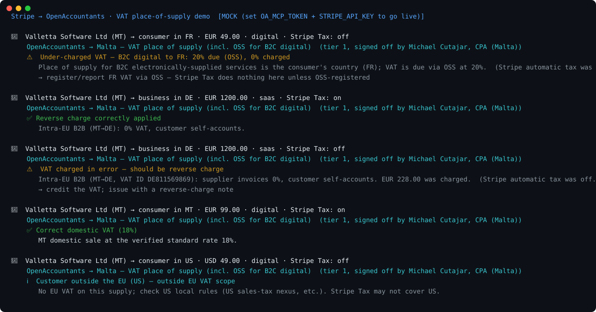

# Stripe → OpenAccountants: VAT place-of-supply demo

**The pitch in one line:** Stripe moves the money. OpenAccountants tells you whether the **VAT/GST on the sale is right** — the correct place of supply across 190+ jurisdictions, including the cases Stripe Tax silently skips when you're not registered — signed off by a named licensed accountant.

```
Stripe sale
  └─ { seller_country, customer_country, vat_id, product_type, net, tax_charged }
        └─ OpenAccountants MCP  →  load the verified place-of-supply skill
              └─ Verdict:  ✅ correct (domestic / reverse charge / OSS)
                           ⚠️ under-charged — B2C digital VAT due at the customer's country (OSS)   ← the catch
                           ⚠️ VAT charged where reverse charge applies
                 · the rule that decided it (cited)
                 · the named CPA who signed it off
```



> Regenerate the visual: `python make_svg.py` (static SVG, no deps) · animated GIF: `brew install vhs && vhs demo.tape`

## Why this is a partnership, not an overlap

- **Stripe = the money rail** (+ Stripe Tax for *calculation*, but only where you're registered, across a narrow set of countries).
- **OpenAccountants = the correctness + accountability layer.** Verified place-of-supply across every jurisdiction → with a named accountant's sign-off, agent-native over an MCP.

Stripe Tax computes tax **only for the countries you've registered in**, and goes quiet everywhere else — exactly where mistakes (and liabilities) accumulate. OpenAccountants is the independent check that catches the long tail and the misconfigurations, without the merchant owning nexus research or hiring a CPA per country.

## What it shows

A sample of sales from a Maltese SaaS seller, run through the OpenAccountants MCP:

| Sale | Verdict |
|---|---|
| B2C digital → FR consumer, **0% charged, Stripe Tax off** | ⚠️ **Under-charged — FR 20% due under OSS** |
| B2B → DE business (VAT ID), 0% | ✅ Reverse charge correctly applied |
| B2B → DE business (VAT ID), **19% charged** | ⚠️ **VAT charged in error — should be reverse charge** |
| Domestic MT consumer, 18% | ✅ Correct domestic VAT |
| B2C digital → US consumer | ℹ️ Outside EU VAT scope — check US nexus (Stripe Tax may not cover) |

**The money shot:** a B2C digital sale to a French consumer with **automatic tax off and €0 VAT**. The place of supply for B2C electronically-supplied services is the **consumer's** country — so French 20% VAT is due via OSS. Stripe collects nothing here unless you're OSS-registered; **OpenAccountants is the layer that catches the under-collection** before it becomes a liability.

## Run it

```bash
git clone https://github.com/openaccountants/stripe-vat-demo
cd stripe-vat-demo
python pipeline.py                  # bundled sample sales (mock mode, no keys)
python pipeline.py samples/sales.json
```

### Go live

```bash
export OA_MCP_TOKEN=...     # OpenAccountants account token (the MCP requires auth)
export STRIPE_API_KEY=...   # a Stripe TEST key is fine (sk_test_...)
python pipeline.py
```

- With `OA_MCP_TOKEN`, `oa_client.py` calls the live MCP (`start` → `get_skill`).
- With `STRIPE_API_KEY`, `stripe_client.py` lists real Checkout Sessions instead of the bundled sample.
- With neither, it runs on the sample sales so the flow is visible today.

## Files

| File | Role |
|------|------|
| `pipeline.py` | Orchestrator + CLI: Stripe → OA → verdict report |
| `stripe_client.py` | Stripe sale extraction (live API or bundled sample) |
| `oa_client.py` | OpenAccountants MCP JSON-RPC client (live or mock) |
| `vat_check.py` | Applies the loaded place-of-supply rules → verdict |
| `samples/sales.json` | Stripe-shaped sales |

## Honest notes

- `vat_check.py` is a **deliberate simplification** (domestic / intra-EU B2B reverse charge / intra-EU B2C-digital OSS / non-EU) — distance-selling thresholds, exemptions, and goods specifics are omitted. Production leans on the full OA skill + an agent step; the named-CPA sign-off makes the verdict relianceable.
- The verifier (Michael Cutajar, CPA Malta) is the real OpenAccountants MT lead; live, every value comes from `get_skill`.
